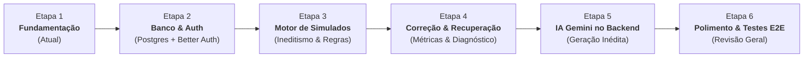

# Plano de Implementação: AWS Simulados (CLF-C02)

Este documento descreve o roteiro estruturado de desenvolvimento do projeto, dividido em fases incrementais, didáticas e verificáveis, projetadas para manter a complexidade controlada e o código sustentável.

---

## 📌 Visão Geral do Cronograma de Etapas

---

## 🚀 Detalhamento das Etapas

### [x] Etapa 1: Fundamentação e Baseline (Concluída)
- [x] Diagnóstico do ambiente Windows (Node.js, npm, PostgreSQL 18, Git).
- [x] Inicialização do repositório Git local e convenções de `.gitignore`.
- [x] Estrutura inicial Next.js com TypeScript estrito, Tailwind CSS e Vitest.
- [x] Elaboração do `PROJECT_SPEC.md` e regras persistentes em `AGENTS.md`.
- [x] Elaboração do `.env.example` sem exposição de credenciais.
- [x] Interface inicial funcional demonstrando seleção de tamanho (15, 30, 45, 65) e tópicos do exame.
- [x] Componente de questão demonstrando 4 alternativas + opção obrigatória "Não sei" sem expor gabarito no client.
- [x] Testes unitários iniciais das regras de negócio e validação com `vitest`.

---

### [x] Etapa 2: Persistência Local e Autenticação (Concluída)
**Objetivo:** Estabelecer a camada de dados no PostgreSQL local e autenticação de usuários via Better Auth.
- **Tarefas Concluídas:**
  1. Configuração do schema relacional no `prisma/schema.prisma`:
     - Modelos de autenticação: `User`, `Session`, `Account`, `Verification`.
     - Modelo de perfil do estudante: `Profile` (curso ADS, métricas e estatísticas).
     - Modelos de simulado: `Question`, `ExamAttempt`, `ExamAnswer`.
  2. Migração versionada gerada e aplicada com sucesso:
     - `prisma/migrations/20261027184200_init_auth_and_exam_schema/migration.sql` aplicada via `prisma migrate deploy`.
  3. Configuração do **Better Auth** com adaptador Prisma para PostgreSQL:
     - Inicialização do backend em `src/lib/auth.ts`.
     - Cliente React em `src/lib/auth-client.ts`.
     - Rota Next.js App Router em `/api/auth/[...all]`.
  4. Telas completas de autenticação e proteção no servidor:
     - `/cadastro` (registro seguro com validação de senha).
     - `/login` (autenticação com feedback em tempo real).
     - `/dashboard` (página privada protegida no servidor com `getServerSession` e exibição de histórico).
     - Botão de Logout integrado com encerramento de sessão e atualização do estado global.
  5. Testes automatizados de persistência e isolamento de dados:
     - `tests/persistence.test.ts`: Testes reais de CRUD, unicidade de e-mail e cascata no PostgreSQL.
     - `tests/authorization.test.ts`: Testes de Tenant Isolation e proteção contra acesso indevido (IDOR).
- **Critério de Aceitação:** 100% cumprido — cadastro, login, logout, sessão persistida no PostgreSQL local e proteção validada no servidor.

---

### [x] Etapa 3: Execução do Simulado com Gerador Local Fictício e Proteção do Gabarito (Concluída)
**Objetivo:** Permitir ao estudante configurar e realizar simulados realistas com gerador local fictício, garantindo proteção de gabarito e persistência do progresso.
- **Tarefas Concluídas:**
  1. Tela de Configuração:
     - Dificuldade fixa: "Difícil".
     - Certificação fixa: "AWS Certified Cloud Practitioner (CLF-C02)".
     - Quantidade estrita de perguntas: 15, 30, 45 ou 65 questões.
     - Seleção múltipla de tópicos com a opção "Todos os tópicos" operando de forma estritamente exclusiva.
  2. Gerador Local de Dados Fictícios:
     - Banco curado local com 66 questões realistas cobrindo os 4 domínios da prova AWS CLF-C02, sem chamadas a APIs ou dependência de IA.
  3. Proteção do Gabarito no Servidor:
     - Endpoint `POST /api/simulados/iniciar`: Registra a tentativa no PostgreSQL local e envia apenas questões sanitizadas para o cliente. O gabarito (`correctOptionId`) e as explicações permanecem restritos ao servidor durante a prova.
     - Endpoint `POST /api/simulados/[id]/finalizar`: Recebe as respostas, processa a correção no servidor, persiste no PostgreSQL e libera o relatório com as explicações comentadas.
  4. Tela da Prova e Persistência:
     - Navegação direta entre questões (Anterior, Próxima e Drawer com grade interativa de 1 a N).
     - Marcador para revisão ("Marcar para revisão") com identificação visual por cores.
     - 4 alternativas autênticas + 5ª opção fixa `"Não sei"`.
     - Persistência contínua do progresso no `localStorage` e integridade caso a página seja recarregada.
     - Modal de confirmação antes da submissão com resumo de questões em branco e marcadas para revisão.
  5. Testes Automatizados com Vitest:
     - `tests/topicSelection.test.ts`: Exclusividade de "Todos os tópicos".
     - `tests/examExecution.test.ts`: Integridade das questões, bloqueio de gabarito e avaliação oficial.
- **Critério de Aceitação:** 100% cumprido — simulado funcional em localhost, sem chamadas a serviços externos, proteção de gabarito e testes validados.

---

### [ ] Etapa 4: Motor de Correção, Diagnóstico e Simulado de Recuperação
**Objetivo:** Avaliar tentativas, gerar relatórios pedagógicos detalhados e viabilizar a recuperação.
- **Tarefas Principais:**
  1. Endpoint de submissão do exame (`POST /api/simulados/[id]/finalizar`):
     - Recebe array de `{ questionId, selectedOptionId }`.
     - Valida contra as respostas corretas no PostgreSQL.
     - Computa pontuação e categoriza cada item em: `CORRETA`, `ERRADA`, `NAO_SEI`, `NAO_RESPONDIDA`.
  2. Página de Resultados:
     - Percentual geral e status (Aprovado / Precisa Praticar).
     - Gráfico de desempenho por Domínio do CLF-C02.
     - Diferenciação visual entre "Erros Conceituais" e "Dúvidas Assumidas (Não sei)".
     - Liberação do gabarito comentado para estudo pós-prova.
  3. Simulado de Recuperação:
     - Botão "Gerar Simulado de Recuperação" a partir dos resultados.
     - Monta um teste com os tópicos/questões onde o estudante pontuou `ERRADA` ou `NAO_SEI`.
- **Critério de Aceitação:** Correção precisa com relatório diagnóstico e geração instantânea de simulado de recuperação.

---

### [ ] Etapa 5: Geração de Questões com Google Gemini (Server-side)
**Objetivo:** Ampliar o banco de questões sob demanda através da inteligência artificial do Gemini, mantendo o nível difícil do exame.
- **Tarefas Principais:**
  1. Criação de serviço server-side seguro (`src/lib/gemini.ts`):
     - Leitura da chave `GEMINI_API_KEY` exclusivamente pelo Node.js.
     - Prompt engineering calibrado para o padrão AWS CLF-C02: questões situacionais baseadas em cenários reais, 4 alternativas de alta plausibilidade e 1 correta indiscutível.
  2. Validador de Schema JSON estrito:
     - Assegura que o retorno da IA contenha enunciado, 4 opções válidas, gabarito e explicação detalhada com citação do serviço AWS.
  3. Pipeline de Moderação e Inclusão no Banco:
     - Endpoint administrativo ou de geração em lote para enriquecer o PostgreSQL.
- **Critério de Aceitação:** Novas questões geradas via Gemini no servidor e salvas no banco local sem expor chaves ou quebrar a estrutura da prova.

---

### [ ] Etapa 6: Polimento, Acessibilidade e Testes Finais
**Objetivo:** Refinamento da usabilidade, robustez de dados e cobertura de testes.
- **Tarefas Principais:**
  1. Atalhos de teclado para navegação no simulado (A, B, C, D, N para Não sei, setas para próxima/anterior).
  2. Modo escuro / alto contraste para longas sessões de estudo.
  3. Testes unitários e de integração adicionais.
  4. Revisão da documentação final e guia do estudante.
- **Critério de Aceitação:** Plataforma estável, acessível e pronta para estudo diário.
