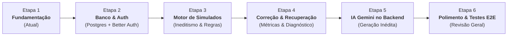

# Plano de Implementação: AWS Simulados (CLF-C02)

Este documento descreve o roteiro estruturado de desenvolvimento do projeto, dividido em fases incrementais, didáticas e verificáveis, projetadas para manter a complexidade controlada e o código sustentável.

---

## 📌 Visão Geral do Cronograma de Etapas

---

## 🚀 Detalhamento das Etapas

### [x] Etapa 1: Fundamentação e Baseline (Concluída)
- [x] Diagnóstico do ambiente Windows (Node.js, npm, PostgreSQL 18, Git).
- [x] Inicialização do repositório Git local e convenções de `.gitignore`.
- [x] Estrutura inicial Next.js com TypeScript estrito, Tailwind CSS e Vitest.
- [x] Elaboração do `PROJECT_SPEC.md` e regras persistentes em `AGENTS.md`.
- [x] Elaboração do `.env.example` sem exposição de credenciais.
- [x] Interface inicial funcional demonstrando seleção de tamanho (15, 30, 45, 65) e tópicos do exame.
- [x] Componente de questão demonstrando 4 alternativas + opção obrigatória "Não sei" sem expor gabarito no client.
- [x] Testes unitários iniciais das regras de negócio e validação com `vitest`.

---

### [x] Etapa 2: Persistência Local e Autenticação (Concluída)
**Objetivo:** Estabelecer a camada de dados no PostgreSQL local e autenticação de usuários via Better Auth.
- **Tarefas Concluídas:**
  1. Configuração do schema relacional no `prisma/schema.prisma`:
     - Modelos de autenticação: `User`, `Session`, `Account`, `Verification`.
     - Modelo de perfil do estudante: `Profile` (curso ADS, métricas e estatísticas).
     - Modelos de simulado: `Question`, `ExamAttempt`, `ExamAnswer`.
  2. Migração versionada gerada e aplicada com sucesso:
     - `prisma/migrations/20261027184200_init_auth_and_exam_schema/migration.sql` aplicada via `prisma migrate deploy`.
  3. Configuração do **Better Auth** com adaptador Prisma para PostgreSQL:
     - Inicialização do backend em `src/lib/auth.ts`.
     - Cliente React em `src/lib/auth-client.ts`.
     - Rota Next.js App Router em `/api/auth/[...all]`.
  4. Telas completas de autenticação e proteção no servidor:
     - `/cadastro` (registro seguro com validação de senha).
     - `/login` (autenticação com feedback em tempo real).
     - `/dashboard` (página privada protegida no servidor com `getServerSession` e exibição de histórico).
     - Botão de Logout integrado com encerramento de sessão e atualização do estado global.
  5. Testes automatizados de persistência e isolamento de dados:
     - `tests/persistence.test.ts`: Testes reais de CRUD, unicidade de e-mail e cascata no PostgreSQL.
     - `tests/authorization.test.ts`: Testes de Tenant Isolation e proteção contra acesso indevido (IDOR).
- **Critério de Aceitação:** 100% cumprido — cadastro, login, logout, sessão persistida no PostgreSQL local e proteção validada no servidor.

---

### [x] Etapa 3: Execução do Simulado com Gerador Local Fictício e Proteção do Gabarito (Concluída)
**Objetivo:** Permitir ao estudante configurar e realizar simulados realistas com gerador local fictício, garantindo proteção de gabarito e persistência do progresso.
- **Tarefas Concluídas:**
  1. Tela de Configuração:
     - Dificuldade fixa: "Difícil".
     - Certificação fixa: "AWS Certified Cloud Practitioner (CLF-C02)".
     - Quantidade estrita de perguntas: 15, 30, 45 ou 65 questões.
     - Seleção múltipla de tópicos com a opção "Todos os tópicos" operando de forma estritamente exclusiva.
  2. Gerador Local de Dados Fictícios:
     - Banco curado local com 66 questões realistas cobrindo os 4 domínios da prova AWS CLF-C02, sem chamadas a APIs ou dependência de IA.
  3. Proteção do Gabarito no Servidor:
     - Endpoint `POST /api/simulados/iniciar`: Registra a tentativa no PostgreSQL local e envia apenas questões sanitizadas para o cliente. O gabarito (`correctOptionId`) e as explicações permanecem restritos ao servidor durante a prova.
     - Endpoint `POST /api/simulados/[id]/finalizar`: Recebe as respostas, processa a correção no servidor, persiste no PostgreSQL e libera o relatório com as explicações comentadas.
  4. Tela da Prova e Persistência:
     - Navegação direta entre questões (Anterior, Próxima e Drawer com grade interativa de 1 a N).
     - Marcador para revisão ("Marcar para revisão") com identificação visual por cores.
     - 4 alternativas autênticas + 5ª opção fixa `"Não sei"`.
     - Persistência contínua do progresso no `localStorage` e integridade caso a página seja recarregada.
     - Modal de confirmação antes da submissão com resumo de questões em branco e marcadas para revisão.
  5. Testes Automatizados com Vitest:
     - `tests/topicSelection.test.ts`: Exclusividade de "Todos os tópicos".
     - `tests/examExecution.test.ts`: Integridade das questões, bloqueio de gabarito e avaliação oficial.
- **Critério de Aceitação:** 100% cumprido — simulado funcional em localhost, sem chamadas a serviços externos, proteção de gabarito e testes validados.

---

### [x] Etapa 4: Correção, Diagnóstico, Modos e Simulado de Recuperação (Concluída)
- [x] Login obrigatório: `/` redireciona para `/login` (ou `/simulado` se já autenticado); `/simulado`, `/dashboard` e todas as APIs de simulado exigem sessão válida no servidor (middleware + verificação em cada página/rota). Usuário convidado removido.
- [x] Escolha obrigatória entre **Modo Estudo** (nota, relatórios e explicação de todas as questões) e **Modo Prova** (somente nota e relatórios; o servidor não envia gabarito nem explicações).
- [x] Serviço único no servidor (`src/lib/exam-service.ts`) com rotas: `POST /api/simulados/iniciar`, `GET /api/simulados/[id]`, `PATCH /api/simulados/[id]/progresso`, `POST /api/simulados/[id]/finalizar`, `GET /api/simulados/[id]/resultado`, `POST /api/simulados/[id]/recuperacao`.
- [x] Questões persistidas por tentativa (`ExamAnswer` criado no início com posição e ordem embaralhada das alternativas); a correção usa somente o banco, nunca IDs enviados pelo cliente.
- [x] Relatório: acertos, erros, "Não sei", não respondidas, percentual, pontuação estimada, desempenho por domínio e por tópico e revisão detalhada (somente no Modo Estudo). Disponível também pelo histórico (`/simulado?resultado=<id>`).
- [x] Botão **"Gerar simulado com os tópicos em que errei"**: usa somente os tópicos com `ERRADA` ou `NAO_SEI`, mantém o modo, marca `isRecovery` e nunca reutiliza questões já apresentadas ao usuário (se faltarem inéditas, informa em vez de repetir).
- [x] Sem pistas durante a prova: tópico removido da tela e do payload (o nome do tópico revelava o serviço correto), texto sugestivo da opção "Não sei" removido, alternativas embaralhadas por tentativa (62 das 66 questões do banco tinham a correta na letra A) e 13 questões do banco reescritas por terem a correta muito mais longa ou com termos repetidos do enunciado.
- [x] Interface sem menções às tecnologias internas.

### [x] Etapa 5: Ampliação do Banco de Questões no Servidor (Concluída)
- [x] Seleção sem repetição (`src/lib/question-generator.ts`): primeiro questões inéditas do banco; se faltarem, gera novas no servidor; reutiliza vistas (as mais antigas) só em simulados normais e só quando o banco do tópico se esgota; nunca repete dentro do mesmo simulado.
- [x] Validação antes de usar (`src/lib/question-quality.ts`): estrutura, subtópico permitido, hash do enunciado, duplicata aproximada (Jaccard ≥ 0,6) e detecção de pistas (correta muito mais longa, enunciado com termos exclusivos da correta, "todas/nenhuma das anteriores", alternativas repetidas). Questões aceitas são salvas no banco.
- [x] Modelos padrão `gemini-3.5-flash` com fallback para `gemini-flash-lite-latest` (ou o definido em `GEMINI_MODEL`): o modelo anterior (`gemini-2.5-flash`) responde 404 ("no longer available to new users") para a chave configurada, então a geração nunca funcionava e o sistema completava o simulado repetindo questões.

### [x] Segurança revisada
- [x] Toda consulta de simulado filtra por `id` **e** `userId`; simulado de outra conta responde 404 (sem revelar existência).
- [x] Finalização atômica (`updateMany ... finishedAt: null`): não é possível finalizar duas vezes nem corrigir simulado alheio.
- [x] Validação dos corpos das requisições; respostas só para questões do próprio simulado e alternativas válidas.
- [x] Better Auth com `secret`, `baseURL`, `trustedOrigins`, senha de 8 a 128 caracteres e limite de tentativas de login/cadastro.
- [x] Cabeçalhos de segurança, `poweredByHeader: false`, `Cache-Control: no-store` nas APIs e log de queries desativado.
- [x] Usuário do banco com privilégios mínimos (`prisma/sql/least-privilege-role.sql`): somente SELECT/INSERT/UPDATE/DELETE; sem CREATE/DROP/TRUNCATE nem acesso à tabela de migrations.

### Resultados reais da verificação (27/10/2026, Ubuntu, Node 24.19, PostgreSQL local)
| Verificação | Comando | Resultado |
|---|---|---|
| Unitários + integração (banco real) | `npm run test` | 11 arquivos, 56 testes aprovados |
| Mesma suíte com usuário de privilégios mínimos | `DATABASE_URL=<aws_simulado_app> npm run test` | 11 arquivos, 56 testes aprovados |
| Navegador (Playwright, build de produção) | `npm run test:e2e` | 3 testes aprovados |
| Lint | `npm run lint` | sem avisos nem erros |
| Tipos | `npm run typecheck` | sem erros |
| Build de produção | `npm run build` | concluído |

Os testes de navegador rodam sem a chave do gerador (somente banco de questões). Geração real verificada manualmente com a chave configurada: pedido de 15 questões só de "Planos de Suporte da AWS" e "AWS Trusted Advisor" (banco tinha 3) completou com 12 novas questões em ~13 s, todas únicas e dos tópicos pedidos; 2 geradas foram descartadas pelo filtro de pistas.

Pendências conhecidas: `npm audit` aponta vulnerabilidades em dependências (não corrigidas para evitar atualizações de versão sem aprovação); `next lint` está obsoleto e será removido no Next.js 16.

---

### [ ] Etapa 6: Polimento e Acessibilidade
- Atalhos de teclado (A, B, C, D, N, setas), modo escuro/alto contraste e guia do estudante.
