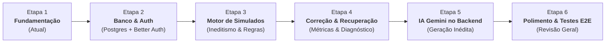

# Plano de Implementação: AWS Simulados (CLF-C02)

Este documento descreve o roteiro estruturado de desenvolvimento do projeto, dividido em fases incrementais, didáticas e verificáveis, projetadas para manter a complexidade controlada e o código sustentável.

---

## 📌 Visão Geral do Cronograma de Etapas

---

## 🚀 Detalhamento das Etapas

### [x] Etapa 1: Fundamentação e Baseline (Em Conclusão)
- [x] Diagnóstico do ambiente Windows (Node.js, npm, PostgreSQL 18, Git).
- [x] Inicialização do repositório Git local e convenções de `.gitignore`.
- [x] Estrutura inicial Next.js com TypeScript estrito, Tailwind CSS e Vitest.
- [x] Elaboração do `PROJECT_SPEC.md` e regras persistentes em `AGENTS.md`.
- [x] Elaboração do `.env.example` sem exposição de credenciais.
- [x] Interface inicial funcional demonstrando seleção de tamanho (15, 30, 45, 65) e tópicos do exame.
- [x] Componente de questão demonstrando 4 alternativas + opção obrigatória "Não sei" sem expor gabarito no client.
- [x] Testes unitários iniciais das regras de negócio e validação com `vitest`.

---

### [ ] Etapa 2: Persistência Local e Autenticação
**Objetivo:** Estabelecer a camada de dados no PostgreSQL local e autenticação de usuários via Better Auth.
- **Tarefas Principais:**
  1. Configuração do arquivo `prisma/schema.prisma` com os modelos:
     - `User`, `Session`, `Account` (para Better Auth).
     - `Question` (enunciado, domínio, tópico, opções A-D, gabarito, explicação, ativa/inativa).
     - `ExamAttempt` (usuário, data de início/fim, configuração, nota final, status).
     - `ExamAnswer` (relação entre tentativa, questão, alternativa escolhida, status: CORRETA, ERRADA, NAO_SEI, NAO_RESPONDIDA).
  2. Criação do banco `aws_simulado_db` no PostgreSQL local via comando `psql`.
  3. Execução das migrations iniciais via Prisma (`prisma migrate dev`).
  4. Configuração das rotas de autenticação do Better Auth (`/api/auth/[...all]`).
  5. Telas de Cadastro, Login e Perfil do Estudante.
- **Critério de Aceitação:** Usuário cadastra-se e faz login no PostgreSQL local, e a sessão é validada pelo Next.js.

---

### [ ] Etapa 3: Motor de Geração e Ineditismo de Questões
**Objetivo:** Permitir ao usuário autenticado gerar simulados oficiais e personalizados sem repetição precoce.
- **Tarefas Principais:**
  1. Carga inicial de questões canônicas do exame CLF-C02 no banco (`prisma/seed.ts`).
  2. Implementação do algoritmo de seleção de questões:
     - Filtrar questões por domínios selecionados.
     - Excluir IDs de questões já respondidas pelo usuário em tentativas anteriores (regra de ineditismo).
     - Caso o banco de inéditas não atinja o total solicitado (ex: 65), aplicar estratégia de fallback avisando o estudante.
  3. API de criação de tentativa (`POST /api/simulados/iniciar`):
     - Registra o início da tentativa no banco.
     - Retorna para o frontend as questões **sanitizadas** (sem gabarito e sem justificativas).
  4. Interface do Simulado em Andamento:
     - Navegação entre questões (1 a N).
     - Marcador de revisão.
     - Cronômetro opcional do exame.
- **Critério de Aceitação:** Simulado montado dinamicamente com 15, 30, 45 ou 65 perguntas, embaralhamento e proteção absoluta do gabarito.

---

### [ ] Etapa 4: Motor de Correção, Diagnóstico e Simulado de Recuperação
**Objetivo:** Avaliar tentativas, gerar relatórios pedagógicos detalhados e viabilizar a recuperação.
- **Tarefas Principais:**
  1. Endpoint de submissão do exame (`POST /api/simulados/[id]/finalizar`):
     - Recebe array de `{ questionId, selectedOptionId }`.
     - Valida contra as respostas corretas no PostgreSQL.
     - Computa pontuação e categoriza cada item em: `CORRETA`, `ERRADA`, `NAO_SEI`, `NAO_RESPONDIDA`.
  2. Página de Resultados:
     - Percentual geral e status (Aprovado / Precisa Praticar).
     - Gráfico de desempenho por Domínio do CLF-C02.
     - Diferenciação visual entre "Erros Conceituais" e "Dúvidas Assumidas (Não sei)".
     - Liberação do gabarito comentado para estudo pós-prova.
  3. Simulado de Recuperação:
     - Botão "Gerar Simulado de Recuperação" a partir dos resultados.
     - Monta um teste com os tópicos/questões onde o estudante pontuou `ERRADA` ou `NAO_SEI`.
- **Critério de Aceitação:** Correção precisa com relatório diagnóstico e geração instantânea de simulado de recuperação.

---

### [ ] Etapa 5: Geração de Questões com Google Gemini (Server-side)
**Objetivo:** Ampliar o banco de questões sob demanda através da inteligência artificial do Gemini, mantendo o nível difícil do exame.
- **Tarefas Principais:**
  1. Criação de serviço server-side seguro (`src/lib/gemini.ts`):
     - Leitura da chave `GEMINI_API_KEY` exclusivamente pelo Node.js.
     - Prompt engineering calibrado para o padrão AWS CLF-C02: questões situacionais baseadas em cenários reais, 4 alternativas de alta plausibilidade e 1 correta indiscutível.
  2. Validador de Schema JSON estrito:
     - Assegura que o retorno da IA contenha enunciado, 4 opções válidas, gabarito e explicação detalhada com citação do serviço AWS.
  3. Pipeline de Moderação e Inclusão no Banco:
     - Endpoint administrativo ou de geração em lote para enriquecer o PostgreSQL.
- **Critério de Aceitação:** Novas questões geradas via Gemini no servidor e salvas no banco local sem expor chaves ou quebrar a estrutura da prova.

---

### [ ] Etapa 6: Polimento, Acessibilidade e Testes Finais
**Objetivo:** Refinamento da usabilidade, robustez de dados e cobertura de testes.
- **Tarefas Principais:**
  1. Atalhos de teclado para navegação no simulado (A, B, C, D, N para Não sei, setas para próxima/anterior).
  2. Modo escuro / alto contraste para longas sessões de estudo.
  3. Testes unitários e de integração adicionais.
  4. Revisão da documentação final e guia do estudante.
- **Critério de Aceitação:** Plataforma estável, acessível e pronta para estudo diário.
