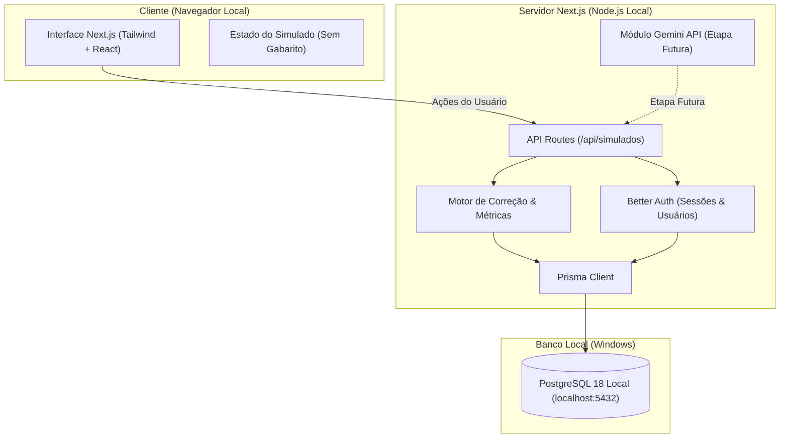

# Especificação do Projeto: AWS Simulados (CLF-C02)

**Versão da Especificação:** 1.0  
**Público-alvo:** Estudantes de TI (Análise e Desenvolvimento de Sistemas) e candidatos à certificação AWS Certified Cloud Practitioner.  
**Autor:** Engenharia de Software / Pair Programming  
**Status:** Em Implementação (Etapa 1: Fundamentação e Baseline)

---

## 1. Visão Geral do Produto

O **AWS Simulados** é uma aplicação web interativa focada no aprendizado e preparação para o exame **AWS Certified Cloud Practitioner (CLF-C02)**. 

Diferente de bancos de questões estáticos e triviais, o sistema foca em:
1. **Rigor pedagógico com opção "Não sei":** Evita que o estudante chute respostas aleatórias sem identificar deficiências reais de estudo.
2. **Separação estrita de segurança e gabarito:** O cliente/navegador não tem acesso à resposta correta antes do término do exame.
3. **Simulados adaptativos e de recuperação:** Criação de testes dedicados a revisar conceitos onde o usuário demonstrou dúvida ("Não sei") ou errou.
4. **Geração inteligente e ineditismo:** Capacidade de regenerar simulados sem repetir questões já visualizadas e, em etapas futuras, utilizar a API do Google Gemini no servidor para expandir o banco com questões inéditas de nível desafiador.

---

## 2. Requisitos Funcionais (RF)

| ID | Nome do Requisito | Descrição |
|---|---|---|
| **RF-01** | **Configuração de Simulado** | O usuário pode criar um simulado escolhendo o número de questões (**15, 30, 45 ou 65**) e filtrando por um ou mais domínios oficiais da prova CLF-C02. |
| **RF-02** | **Estrutura Quíntupla de Alternativas** | Toda questão exibirá 4 alternativas conceituais plausíveis (A, B, C, D) e uma 5ª opção fixa e obrigatória: `"Não sei"`. |
| **RF-03** | **Segurança de Gabarito em Trânsito** | O gabarito, justificativas e identificador da opção correta **jamais** devem ser transmitidos para o frontend durante a realização da prova. |
| **RF-04** | **Classificação Quadripartite de Respostas** | O motor de correção deve diferenciar 4 categorias ao finalizar o teste: **Correta**, **Errada**, **"Não sei"** e **Não respondida**. |
| **RF-05** | **Ineditismo de Questões** | Ao gerar uma tentativa nova, o sistema deve priorizar questões que o usuário logado ainda não respondeu, evitando repetição precoce. |
| **RF-06** | **Simulado de Recuperação** | Permitir ao estudante gerar um novo simulado composto exclusivamente pelos tópicos/questões que foram marcadas como "Não sei" ou "Errada" em tentativas anteriores. |
| **RF-07** | **Relatório de Desempenho e Diagnóstico** | Apresentar percentual de acertos total e por domínio, tempo gasto, lista de lacunas cognitivas identificadas (tópicos com alto índice de "Não sei" vs Erros conceituais). |
| **RF-08** | **Autenticação Local Segura** | Autenticação via Better Auth armazenando credenciais criptografadas no PostgreSQL local, mantendo histórico de tentativas por usuário. |
| **RF-09** | **Integração Futura com IA (Gemini)** | Mecanismo no backend para geração e validação de questões sob demanda via Gemini API, sem expor chaves ao cliente. |

---

## 3. Requisitos Não Funcionais (RNF)

1. **Arquitetura Estritamente Local:**
   - Todo o ecossistema deve rodar localmente no Windows (`localhost:3000` e PostgreSQL local na porta `5432`).
   - Sem dependência de Docker, Vercel, Supabase ou outros serviços em nuvem gerenciados nesta fase.
2. **Custo Zero:**
   - 100% das ferramentas e bibliotecas empregadas devem ser gratuitas e de código aberto.
3. **Simplicidade e Manutenibilidade:**
   - Código idiomático em TypeScript com Next.js (App Router).
   - Abstrações simples e documentadas para facilitar o aprendizado de estudantes de Análise e Desenvolvimento de Sistemas.
4. **Desempenho e Tipagem:**
   - TypeScript estrito (`strict: true`).
   - Tempo de resposta local inferior a 150ms na transição de questões e submissão.
5. **Acessibilidade e Usabilidade:**
   - Design responsivo, navegação facilitada por teclado, botões de ação com contraste alto e sem ambiguidades visuais.

---

## 4. Domínios Oficiais do Exame AWS CLF-C02

As questões do simulado categorizam-se de acordo com o blueprint oficial da certificação:

1. **Domínio 1: Conceitos de Nuvem (Cloud Concepts) ~ 24%**
   - Definição da AWS Cloud e valor de negócio.
   - Princípios da arquitetura em nuvem (Well-Architected Framework básico).
   - Benefícios econômicos (CapEx vs OpEx).
2. **Domínio 2: Segurança e Conformidade (Security and Compliance) ~ 30%**
   - Modelo de responsabilidade compartilhada da AWS.
   - Gerenciamento de acessos e identidade (IAM).
   - Serviços de segurança essenciais (KMS, Shield, WAF, Security Groups, NACLs).
   - Conceitos de conformidade e governança.
3. **Domínio 3: Tecnologia e Serviços de Nuvem (Cloud Technology and Services) ~ 34%**
   - Infraestrutura global (Regiões, Zonas de Disponibilidade, Edge Locations).
   - Serviços de computação (EC2, Lambda, ECS, Fargate).
   - Serviços de armazenamento (S3, EBS, EFS).
   - Bancos de dados (RDS, DynamoDB, Aurora).
   - Redes (VPC, Route 53, CloudFront).
4. **Domínio 4: Faturamento, Preços e Suporte (Billing, Pricing, and Support) ~ 12%**
   - Modelos de precificação (On-Demand, Spot, Reserved, Savings Plans).
   - Ferramentas de faturamento (AWS Cost Explorer, Budgets, Cost and Usage Report).
   - Planos de suporte da AWS (Basic, Developer, Business, Enterprise).

---

## 5. Regras de Negócio e Algoritmo de Avaliação

### 5.1 Estrutura de Cada Questão
```typescript
interface QuestionOption {
  id: string;          // Ex: "opt_a", "opt_b", "opt_c", "opt_d", "opt_dont_know"
  text: string;        // Texto descritivo da alternativa
  isDontKnow?: boolean;// Flag especial para a opção "Não sei"
}

interface QuestionPublicView {
  id: string;
  domain: string;      // Domínio CLF-C02
  topic: string;       // Assunto específico (ex: "IAM Policies", "S3 Storage Classes")
  stem: string;        // Enunciado da questão
  options: QuestionOption[]; // 4 alternativas + opção "Não sei"
}

// Armazenada no banco / servidor - NUNCA enviada ao cliente durante a prova
interface QuestionPrivatePayload {
  id: string;
  correctOptionId: string;
  explanation: string;
  documentationUrl?: string;
}
```

### 5.2 Avaliação das Respostas Submetidas
Para cada resposta submetida pelo usuário `selectedOptionId`:
- Se `selectedOptionId === null || selectedOptionId === undefined`: Status = `NAO_RESPONDIDA`.
- Se `selectedOptionId === "opt_dont_know"`: Status = `NAO_SEI`.
- Se `selectedOptionId === question.correctOptionId`: Status = `CORRETA` (incrementa score de aprovação).
- Se `selectedOptionId !== question.correctOptionId`: Status = `ERRADA`.

### 5.3 Critério de Aprovação da Certificação AWS
- A prova real adota pontuação de 100 a 1000 com nota de corte em **700 (70%)**.
- O sistema apresentará o percentual bruto e a estimativa correlata de aprovação no exame oficial.

---

## 6. Arquitetura da Solução Local



---

## 7. Critérios de Aceitação da Etapa 1
1. **Configuração e Repositório:**
   - Projeto configurado com TypeScript estrito, Next.js 15, Tailwind CSS, Prisma e Vitest.
   - `.gitignore` protegendo `.env`, dependências e saídas de build.
   - `.env.example` preenchido com orientações didáticas para o PostgreSQL local.
2. **Documentação Técnica Completa:**
   - `PROJECT_SPEC.md`, `IMPLEMENTATION_PLAN.md`, `README.md` e `AGENTS.md` devidamente redigidos em português do Brasil.
3. **Interface Funcional Inicial:**
   - Aplicação rodando em `localhost:3000`.
   - Painel interativo demonstrando a seleção de tópicos e quantidade de questões (15, 30, 45, 65).
   - Visualização de questões simuladas contendo exatamente 4 alternativas e o botão `"Não sei"`.
   - Nenhuma chave de API ou gabarito exposto indevidamente.
4. **Qualidade Verificada:**
   - Execução sem erros de compilação TypeScript (`npm run typecheck`).
   - Suíte de testes unitários iniciais cobrindo as regras de negócio centrais (`npm run test`).
